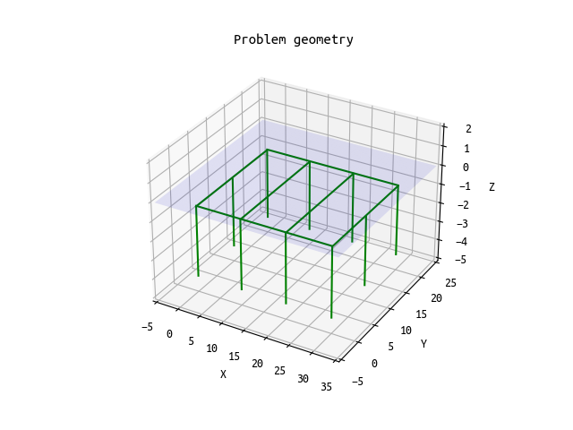
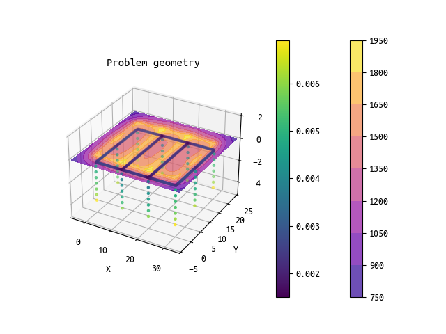
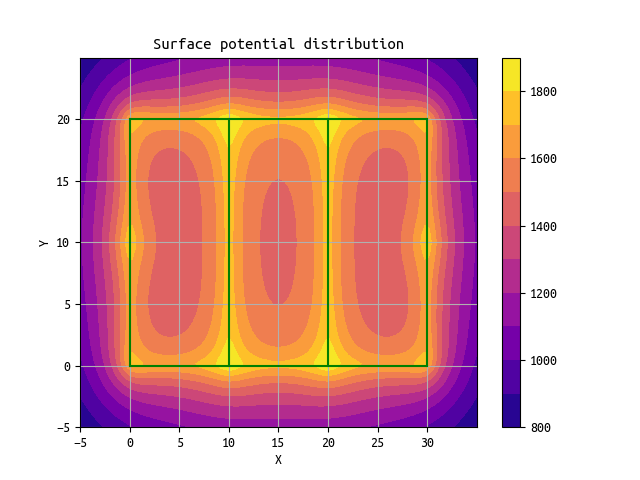
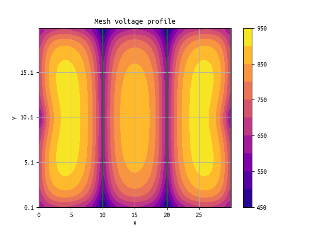
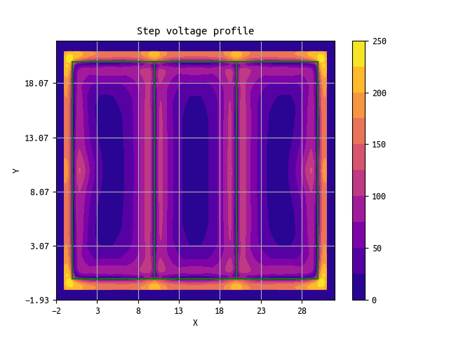

# Earthing

[](https://pypi.org/project/earthing/)
[](https://github.com/manuvarkey/GElectrical/releases/latest)
[](https://github.com/manuvarkey/Earthing/blob/main/LICENSE)

A python library for design of earthing networks in electrical substations. 

## Features

* Earth grid design as per IEEE 80 / ENA EREC S34.
* Electrode resistance by IEEE formulae where available, with ENA EREC S34 and IS 3043 alternatives:
  * grid (IEEE 80 Eq. 52) and grid with rods (Schwarz, IEEE 80 Eqs. 53-56; or ENA S34 R4-R6);
  * rod (IEEE 80 / ENA S34 R1), strip and plate (Dwight, IEEE 142; or ENA S34 R7, R2).
* Mesh and step voltage for rectangular, L-shaped and irregular grids (IEEE 80), with perimeter or interior rods.
* Permissible touch and step voltage: IEEE 80 (50 kg and 70 kg) and ENA TS 41-24 Tables 1 and 2.
* Surface, touch and step potential formulae of ENA EREC S34 (P1-P7).
* Electrode current density limits: ENA S34 C2 (default), IS 3043 and IEEE 142.
* Numerical earth network calculations using boundary discretisation method, validated against the EPRI results of IEEE 80 Annex B Examples 1-4.
* 3D plotting of electrode geometry used for design.
* 3D plotting of current density distribution for the earth network.
* 2D/3D plotting of surface potential distribution.
* Plotting and evaluation of mesh and step potentials.








## Documentation

- [User guide](docs/user-guide.md): installation, units, workflows, and examples.
- [API reference](docs/api-reference.md): exported functions, parameters, return values, and `Network` methods.
- [Validation](validation/README.md): checks against IEEE Std 80-2000, ENA EREC S34, ENA TS 41-24, IS 3043:2018 and IEEE Std 142 worked examples and tables, with the latest [report](validation/report.md).

## Usage

Package is available on PyPI for installation ([https://pypi.org/project/earthing](https://pypi.org/project/earthing/)). Use `python3 -m pip install earthing` to install.

Program source includes detailed usage instructions for various functions and classes. Alternately project page has ipython notebooks covering typical use cases.

```python
from earthing import resistance_grid_with_rods, e_mesh_step_grid, e_touch_70

# 70 m x 70 m grid, 11 x 11 conductors (d = 10 mm) at 0.5 m, 20 rods x 7.5 m
R = resistance_grid_with_rods(400, 4900, 1540, 7.5, 20, 14, 0.016, None, b=0.01)
Em, Es = e_mesh_step_grid(400, 70, 70, 7.5, 11, 11, 20, 0.01, 0.5, 1908)
print(R, Em, Es, e_touch_70(400, 2500, 0.102, 0.5))
```

### Changes in defaults

Recent versions changed some default formulae. Pass `method=` to keep the earlier behaviour:

| Function | New default | Earlier formula |
| --- | --- | --- |
| `resistance_grid_with_rods` | `'IEEE80'` (Schwarz) | `method='S34'` |
| `resistance_plate` | `'IEEE142'` (Dwight) | `method='S34'` |
| `resistance_strip` | `'IEEE142'` (Dwight) | IS 3043:1987 (removed); `method='S34'` for ENA S34 R7 / IS 3043:2018 |
| `max_current_density` | `'S34'` (Formula C2) | `method='IS3043'` |

`Descrete*` classes and `descretise()` are renamed `Discrete*` and `discretise()`; the old names still work with a `DeprecationWarning`.

## Validation

`validation/` checks the package against worked examples and tables of IEEE Std 80-2000, ENA EREC S34, ENA TS 41-24, IS 3043:2018 and IEEE Std 142 (224 cases). Run:

```bash
python3 validation/run_validation.py
```

See [validation/README.md](validation/README.md) for coverage, tolerances, solver step-size guidance and the issues found in the standards.


## Dependencies:

* Python 3
* Numpy
* Matplotlib

